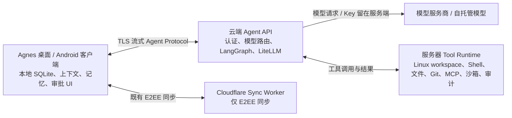

# 云端 AI 核心可行性调研

> 调研日期：2026-10-23
> 状态：架构可行，尚未进入实现
> 范围：客户端保留会话上下文；服务器保存模型配置和 API Key，运行 Agent 核心及工具环境

## 结论

该方案可行，也与 Agnes 已有的 Python LangGraph、LiteLLM 和 Agent Protocol 基础兼容。推荐将云端 AI 作为可选的第三种运行位置，与桌面 Local、Android Local 并存；第一阶段面向单用户自托管服务器，不把它塞进当前 Cloudflare 同步 Worker。

主要工作不在模型请求，而在工具执行边界：今天模型循环在 Python sidecar，shell、文件、Git、MCP、审批、沙箱和审计由本机 Rust Core 执行。要让工具真正运行在服务器，必须在服务器提供受控的执行器，并给每个远端会话分配服务器 workspace。客户端上下文可以沿用现有 snapshot 结构，但必须从请求中移除模型密钥和本机路径。

| 部署形态 | 可行性 | 判断 |
|---|---|---|
| 单用户自托管 Linux 服务器 | 高 | 最适合作为首个版本；服务器可持有模型密钥和文件环境，先服务一个可信账户 |
| Agnes 托管的多用户云服务 | 中 | 模型与工具都可运行，但必须额外解决租户隔离、账号授权、配额、审计、数据保留和滥用防护，成本显著增加 |
| 仅把模型调用代理到云端、工具留在客户端 | 高 | 开发量较小，但不满足“工具环境也在服务器”的目标 |
| 直接在当前 Cloudflare Worker/D1 上运行完整 Agent 和 shell | 低 | 与现有同步服务职责和运行时不匹配；Worker 可作为认证或网关，Linux Agent/工具仍应运行在独立服务器或容器中 |

## 与当前架构的关系

当前桌面和 Android 客户端都能独立运行 Agent。Rust 启动本机 Python sidecar；Python 负责 LangGraph 推理、LiteLLM 请求、提示词组装和流式回复，再通过 WebSocket 把工具调用交还给 Rust。Rust 根据 session/workspace 找本机目录，处理风险审批、沙箱、MCP、工具审计和工具结果。相关边界见 `PROJECT.md`、`src-tauri/src/agent/manager.rs`、`agent/app/main.py` 和 `src-tauri/src/tools/executor.rs`。

运行请求已经由客户端从本地 SQLite 取出 Agent、近期消息、摘要、长期记忆、知识检索、阅读上下文、附件和工具策略，组成 snapshot 后发送给 sidecar（`src-tauri/src/commands/mod.rs` 中的 Agent run context）。因此“客户端管理上下文，云端负责推理和执行”不要求把聊天数据库迁移到服务器：客户端继续是消息与记忆的真相源，每轮只向选定的云端执行器发送该轮所需的上下文快照，完成消息仍写入本地数据库并按既有策略同步。

需要改造的具体边界：

- 当前 snapshot 的 `llmConfig`、备用模型配置和任务模型配置含 API Key。它们目前只发给本机 sidecar；云端请求必须只带服务器可识别的模型部署 ID、能力及生成参数，由服务器从自己的秘密存储解析 Key。
- 当前 snapshot 还可能包含本机 workspace、`attachmentRoot` 或本机附件路径。远端模式应发送稳定的 `remote_workspace_id` 和经过授权的附件内容/对象引用；服务器不能把客户端绝对路径当成可访问路径。
- 当前工具定义包括本机 MCP 动态工具。远端模式需要使用服务器上的工具注册表和 MCP 配置；客户端的 stdio 命令、环境变量和 Keyring 凭证不能自动变成服务器工具。
- 当前内置工具是 Rust 实现并依赖 `DbActorHandle`、`McpManager`、`StorageService`、本机 workspace 解析和 Tauri 事件/生命周期。Python Agent 可复用，但完整工具执行器不能直接搬进普通 FastAPI 进程，需要把依赖拆成可 headless 启动的 Rust 服务，或实现有独立安全边界的服务器执行适配层。

## 建议的目标架构

客户端为每轮运行发送一个有界请求：`run_id`、server-side Agent/模型部署标识、角色卡与工具策略快照、摘要和近期消息、必要的记忆/知识片段、当前用户输入、附件内容或短期下载授权、`remote_workspace_id`、上下文预算和输出限制。不要发送整份本地 SQLite、无关历史、OS Keyring 内容、客户端 API Key、本机绝对路径或原始工具审计数据。

服务器使用现有 Python Agent 图和 LiteLLM 做推理。工具调用由服务器执行器直接调度，不再绕回客户端；客户端通过双向加密连接接收文本增量、工具状态、审批请求、模型回退状态和完成/错误事件。用户拒绝或批准高风险操作、取消运行和断线恢复都应成为显式协议事件。WebSocket/TLS 最贴近现有双向 Agent Protocol；也可采用 HTTPS 创建运行 + SSE 接收流 + REST 审批/取消，但首版应只实现一种传输。

会话历史和记忆正文默认不在服务器长期保存。服务器可以为运行中的工具循环暂存当前轮状态，并用短期 `run_id` 支持重连；完成、取消或超时后按保留策略清理。客户端仍负责保存用户/助手消息、摘要与长期记忆。若未来需要跨设备恢复服务器端长任务，再单独设计任务状态存储和明文保留期。

Cloud 模式的网络或服务故障应明确结束为 Cloud 运行失败，并允许用户手动切回 Local；不应自动把同一上下文和工具任务转到本机，因为两种运行位置的数据路径、密钥和 workspace 都不同。

## 工具与 workspace 的关键设计

“服务器上的工具环境”意味着 Agent 操作的是服务器授权的文件，不是客户端磁盘。首版应提供明确的远端 workspace 绑定：服务器管理员授权一个根目录或创建隔离容器目录，客户端选择或新建其中的 workspace。项目来源可先支持服务器上已有目录或 Git clone；本机目录若要交给服务器，必须由用户显式上传/同步。服务器完成修改后通过 Git push/pull、变更集或加密 artifact 回到客户端。不能隐式假设远端和本机 `folder_path` 指向同一份文件。

自托管单用户也要遵守最小权限：Agent 只获得选定 workspace 的读写能力；shell 子进程在独立用户或容器中运行，限制文件系统、进程、CPU、内存、输出大小、时长和网络；工具调用在服务端重新检查 Agent 策略并记录脱敏审计。当前 Linux 沙箱设计（Landlock、可选 bubblewrap、审批 tier）可以作为实现参考，但服务器需要自己的策略配置和审计存储。模型发出的工具参数、用户上下文和 MCP 返回值都按不可信输入处理。

远端高风险工具审批应由客户端 UI 完成、服务器执行端强制。审批请求绑定 `run_id + tool_call_id + 参数摘要 + 策略版本 + 过期时间`，批准结果一次性使用，避免重放或客户端断线后错误执行。服务器不能只依赖模型隐藏/展示了哪些工具，也不能相信客户端发来的“已批准”布尔值而不验证对应的待处理调用。

## 密钥、E2EE 与隐私边界

- 模型/API Key 只在服务器秘密存储中配置，最好通过服务端环境注入或专用 Secret Store 管理；不能进入数据库明文、运行请求、模型提示词、工具参数、事件流和普通日志。客户端仅选择服务器暴露的模型部署别名。
- Agnes Sync 的 E2EE 继续保护同步 Worker、D1、R2 和存储副本。它不等于推理服务器对上下文零知识：客户端必须在发送前解密并把本轮明文上下文交给 AI 服务器；该服务器以及实际模型供应商都能处理请求明文。产品需按运行位置明确提示此数据流，并提供每次/每 Agent 的云端授权开关。
- 如果服务器是用户自托管，明文处理的信任对象是用户自己的主机；如果服务器由 Agnes 托管，则这成为新的服务端可见数据路径，需要单独定义保留、删除、访问审计和供应商数据处理策略。
- 当前同步 API 的设备 Bearer Token 只授权同步，不应直接授权云端 Agent。Agent 端点使用独立 audience/scope 的短期访问凭证；支持按设备撤销、速率限制、请求大小限制和运行配额。
- 附件使用有期限、限权限的上传/下载授权，或经 TLS 直接传输有大小上限的内容；不接受由模型可控 URL 引发的任意服务端抓取，避免 SSRF。

## 运维和成本

如果服务器只负责通过 LiteLLM 调用外部模型，主要成本仍是 VPS/容器的常驻费用、模型供应商的输入/输出 token 费用和附件传输；服务器本身通常不需要 GPU。若模型也部署在自己的服务器，GPU、显存、存储、电力和模型升级维护会成为主要成本。由于每轮要把客户端上下文发到服务器并继续转发给模型，实际 token 用量和网络数据量取决于摘要、近期历史、知识片段和附件大小，不能只按最后一条用户输入估算。

生产部署还需要 TLS 终止、服务更新、密钥轮换、运行清理、健康检查、限流和可观测性。日志默认只留 run ID、耗时、模型部署别名、用量和归一化错误类别；若用户选择保存提示词或工具输出用于调试，应是单独的明确设置并有过期清理。

## 分阶段落地

1. **运行位置抽象**：在客户端增加 `Local` / `Cloud` 执行器选择和服务器连接配置。服务器连接令牌进入 Keyring/Android Keystore；现有 Local 默认行为不变。模型选择改为稳定部署引用，云端模式不下发 `apiKey`、服务商连接配置、本机路径或本地 MCP Secret。
2. **单用户云端推理 POC**：独立部署 Linux 服务，复用现有 Python LangGraph、LiteLLM、提示词和 fallback 逻辑；用 TLS 双向流协议完成运行、Delta、完成、错误、取消和断线恢复。暂不开放 shell，只做模型往返与客户端消息持久化，验证 Android/桌面连接和请求体裁剪。
3. **服务器工具执行**：抽出可独立启动的 headless Tool Runtime，或建立经过相同安全契约验证的 server adapter。先实现一个 server workspace 的文件读写、搜索、Git 和 shell；接入容器/系统沙箱、工具审批、审计、输出限制和取消。通过变更集/Git 把产物交还给客户端。
4. **MCP 与服务运维**：服务器管理独立 MCP 配置和秘密；加入服务端模型路由、限额、健康状态、日志脱敏、更新兼容性、运行清理和备份策略。单用户自托管稳定后，再评估托管多租户。

首个验收目标应是：同一角色卡和客户端上下文可选择 Local 或 Cloud；Cloud 请求不含模型 Key 与本机路径；服务器日志不记录明文提示词/凭证；远端 shell 只能访问授权 workspace；高风险工具调用需要客户端明确批准；断线或取消后不遗留运行进程；本地消息、记忆和既有 E2EE 同步保持有效。

## 总体判断

采用自托管服务器时，这是一项中等到较大的架构扩展，推理复用度高，工具服务化与远端 workspace 是主要成本；采用多租户产品形态时，隔离和运维成本会成为核心工作。建议先做可选的单用户 Cloud Runtime，不改变 Local-first 主路径，也不依赖把会话数据迁入 D1。当前 Cloudflare Worker 继续做同步控制面；如需要统一公网入口，可让 Worker/Access 转发认证后的请求，但 Agent 计算和文件执行仍放在独立 Linux 服务。

### 调研依据

- `ProjectPlan/PROJECT.md`：Local-first 定位、三端执行架构、模型技术栈与当前路线图。
- `ProjectPlan/CLOUDFLARE_SYNC.md`：Worker/D1 的职责、数据同步边界，以及“云端运行 Python Agent、shell、Git 或 MCP”列为非目标。
- `ProjectPlan/E2EE.md`：同步密钥仅在客户端；Worker、D1、R2 不持有解密密钥。
- `ProjectPlan/MODEL_ROUTING.md`：模型与任务路由，以及 API 配置如何下发给 Python sidecar。
- `ProjectPlan/TOOLS_AND_SANDBOX.md`、`src-tauri/src/tools/executor.rs`：工具风险审批、Linux 沙箱与执行策略。
- `src-tauri/src/commands/mod.rs`、`agent/app/main.py`、`src-tauri/src/agent/manager.rs`：当前上下文 snapshot、LangGraph 运行和 sidecar 生命周期。
