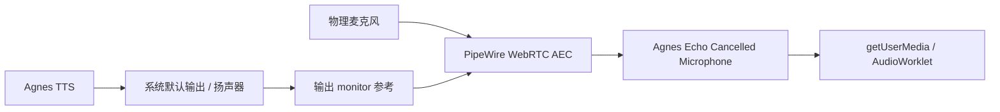

# 语音采集、阶段超时与 Linux 回声消除

> 状态：AudioWorklet 采集和按样本计时的 VAD 已接入；兼容环境保留 ScriptProcessor。麦克风初始化、ASR 和 TTS 等待有超时收尾。PipeWire AEC 已确认本机存在所需组件，配置模板处于待设备验收阶段；自动语音插话仍待实现。

## 1. 已落地的音频采集

`src/lib/voiceCapture.ts` 管理麦克风音频图，优先加载独立打包的 `voiceCapture.worklet.ts`。处理器使用 `voiceVad.ts` 的公共 VAD；AudioWorklet 不可用或本地模块加载失败时，ScriptProcessor 复用同一套逻辑。采集后端和系统报告的音频处理设置写入 `[voice][capture]` 诊断日志，不包含录音、转写、设备 ID 或密钥。

VAD 使用音频样本数计算时长，不依赖 React 状态或 `requestAnimationFrame`。界面动画只读取音量。参数如下：

| 参数 | 当前值 | 用途 |
|---|---:|---|
| 前滚缓冲 | 400 ms | 保留起音前的音频 |
| 起音确认 | 100 ms 有声样本 | 避免瞬时响声立即起音；容许不足 50 ms 的短暂间隙 |
| 最小累计有声时长 | 120 ms | 丢弃过短噪声片段 |
| 封段静音 | 850 ms | 停说后提交识别 |
| 单段音频上限 | 20 秒，包含前滚与尾部静音 | 防止无限积累录音 |
| 音量事件频率 | 约 45 ms | 控制跨线程消息数量 |

VAD 预分配固定大小的前滚环形缓冲和单段缓冲，每个渲染块不创建一份 PCM 数组。完成一句后，先在处理器内关闭采集门控，再把最终 Float32Array 的 ArrayBuffer 转移给 UI；识别、思考、播报期间持续暂停收集。每次静音、恢复、打断或释放资源都会更新采集 epoch；UI 丢弃旧 epoch 的事件，避免已经排队的旧音频成为下一轮输入。门控改变时清空已记录的缓冲区域。

AudioWorklet 输出为静音，并通过零增益节点连接音频图，麦克风声音不会直接传到扬声器。关闭通话会断开节点、关闭 MessagePort、停止麦克风 track 和 AudioContext。权限请求迟到或初始化中途取消时，已取得或稍后取得的资源也会释放。

这一版仍使用 RMS 阈值、起音确认和迟滞，不是神经网络 VAD，也不执行回声消除。浏览器音频线程或系统采集本身暂停时，样本计时也会暂停；它解决的是 VAD 依赖界面动画刷新导致的延迟。

## 2. 阶段超时与恢复

| 阶段 | 限制 | 收尾 |
|---|---:|---|
| 麦克风授权与设备连接 | 60 秒 | 显示重试入口；迟到的 MediaStream 立即停止 |
| AudioContext 启动 | 10 秒 | 释放本轮取得的麦克风与上下文 |
| AudioWorklet 模块加载 | 3 秒 | 使用 ScriptProcessor 兼容采集；取消或上下文已关闭时直接结束初始化 |
| UI 音频转换及 ASR 等待 | 40 秒 | 面板内提示并恢复聆听；取消后立即结束 UI 等待，丢弃迟到结果 |
| Rust ASR 请求 | 35 秒，已有 | 清理等待结果的关联 |
| Qwen HTTP 请求 | 30 秒，已有 | Provider 返回请求错误 |
| UI 等待首个 TTS 音频／完成事件 | 25 秒 | 取消 TTS 与本轮 Agent，清队列并恢复聆听 |
| UI 等待后续 TTS 块／完成事件 | 15 秒 | 每个有效音频块刷新截止时间，超时联动取消本轮回复 |
| CosyVoice Provider 首个事件 | 30 秒 | 关闭异步生成器，触发 SDK 合成取消 |
| CosyVoice Provider 后续事件 | 15 秒 | 同上；等待 WebView ACK 的时间不计入 Provider 取下一块的等待 |
| sidecar 等待单块 ACK | 8 秒，已有 | 结束该请求并清理 ACK future |

UI 的 TTS 超时同时覆盖原生启动命令尚未返回的情况。若启动确认迟于取消，确认后再按同一个请求 ID 取消，防止留下无人消费的流。旧请求不能清掉新请求的定时器或播放状态。

这些处理提供有界等待与错误恢复，不自动重放音频或重发用户消息。ASR 目前只撤销 UI 等待，底层 HTTP 工作线程可能继续运行到请求返回或现有超时；真正的 ASR 请求取消和专用语音话轮协议仍需实现。Agent 长时间思考、执行工具和等待审批的阶段策略也尚未纳入本轮。

## 3. Arch Linux 的 AEC 路径

本机只读检查结果（2026-10-07）：

| 组件 | 结果 |
|---|---|
| WebKitGTK | 2.52.6 |
| PipeWire / pipewire-pulse | 1.6.9 |
| WirePlumber | 0.5.18 |
| WebRTC audio processing | 1.3 |
| PipeWire echo-cancel 模块 | `/usr/lib/pipewire-0.3/libpipewire-module-echo-cancel.so` 存在 |
| WebRTC AEC SPA 插件 | `/usr/lib/spa-0.2/aec/libspa-aec-webrtc.so` 存在 |

WebKitGTK 对 `echoCancellation` 的支持和 track `getSettings()` 的报告只能说明请求与配置，不能证明扬声器回声被有效消除。下一阶段优先验证 PipeWire 的 WebRTC AEC，以系统播放参考补足 WebView 的能力。

PipeWire 本机手册 `libpipewire-module-echo-cancel(7)` 明确支持 `monitor.mode`：从默认输出设备的 monitor 取得播放参考，而不要求 Agnes 把 TTS 送到专用虚拟 sink。这样可以避开 WebKitGTK 的输出设备选择限制。候选模板见 [`voice/60-agnes-echo-cancel.conf`](voice/60-agnes-echo-cancel.conf)，对应以下路由：

模板的生效位置为 `~/.config/pipewire/pipewire.conf.d/60-agnes-echo-cancel.conf`，需重启 PipeWire 加载。加载后，在 Agnes 通话面板选择 `Agnes Echo Cancelled Microphone`；底层 capture 必须仍指向物理麦克风，monitor 必须覆盖 Agnes 实际播放的输出设备。模板为虚拟源设置较低的会话优先级；多声卡、蓝牙或显式默认设备配置下仍需检查真实连接。必要时用物理节点名称指定 `capture.props.target.object` 与 `playback.props.target.object`。

模块和插件存在不等于路由已经工作，候选模板尚未经过真实声卡验收。后续诊断应读取实际设备路由与回灌强度，不能根据设备显示名称自动认定 AEC 有效。采用系统 AEC 后，还需评估浏览器再次处理该虚拟源是否影响双讲时的人声。

### 当前桌面运行时实现

Agnes 在 Linux 桌面启用 AEC 时通过 `pactl load-module module-echo-cancel` 临时创建固定名称的 `agnes.aec.source` 和 `agnes.aec.sink`。物理麦克风连接到 `echo-cancel-capture`，`echo-cancel-playback` 连接到原物理输出；随后把 PulseAudio 默认输入和输出切换到这两个虚拟端点。这样 WebView 的 `getUserMedia()` 采集的是处理后的 source，Web Audio 的 TTS 默认播放则经过 AEC sink 并进入播放参考。关闭 Agnes 或停用 AEC 时只在默认设备仍指向 Agnes 端点的情况下恢复原设备，避免覆盖用户在通话期间的手动切换。

启动状态同时检查默认端点、虚拟节点以及两条 PipeWire Link；任一路由消失都会暂停语音采集并要求重新连接。`src-tauri/examples/voice_aec.rs routes` 可在真实设备上执行一次加载、状态检查和清理。此方案仍需人工试听双讲和扬声器回灌效果；路由通过不等于 AEC 效果已经达到全双工验收标准。

参考：本机 PipeWire 1.6.9 手册；[PipeWire Echo Cancel 文档](https://docs.pipewire.org/page_module_echo_cancel.html)。

## 4. 下一阶段完成条件

1. 扬声器只播放 Agnes 回复时，AEC 后输入不触发新用户话轮；确认 TTS 的真实播放参考已进入滤波器。
2. 用户在 TTS 播放时正常说话，AEC 后仍保留可识别的人声；分别验证扬声器、耳机与两者设备切换。
3. 在以上条件满足后，增加播放期间采集、双讲判断和自动插话；保留当前手动打断入口。
4. 对快速插话与重开通话，建立专用 voice_session_id/turn_id 并补齐 ASR 请求取消，过滤全部迟到数据。
5. 记录连续 20 轮通话的封段、ASR、首文本、首音频、句间停顿及打断耗时；构建检查仅证明可编译和正确打包，不能作为音频效果验收。
